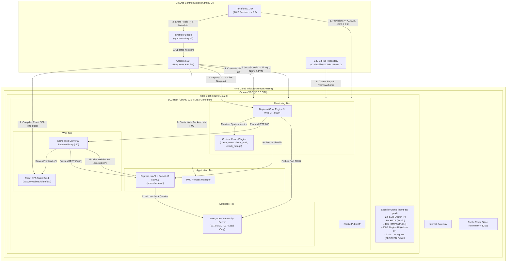

# 🩸 Blood Bank Management System (BBMS) v2.0
### Enterprise MERN Application with Automated DevOps Infrastructure (Terraform, Ansible & Nagios 4)

[](https://www.terraform.io/)
[](https://www.ansible.com/)
[](https://www.nagios.org/)
[](https://aws.amazon.com/)
[](https://ubuntu.com/)
[](https://nodejs.org/)
[](https://react.dev/)
[](https://www.mongodb.com/)
[](https://nginx.org/)
[](https://pm2.keymetrics.io/)

---

## 📑 Table of Contents
1. [Project Introduction](#1-project-introduction)
2. [Existing BBMS Architecture](#2-existing-bbms-architecture)
3. [DevOps Architecture](#3-devops-architecture)
4. [Tools and Technologies](#4-tools-and-technologies)
5. [Terraform – Infrastructure as Code (IaC)](#5-terraform--infrastructure-as-code-iac)
6. [Ansible – Configuration Management & Deployment](#6-ansible--configuration-management--deployment)
7. [Nagios 4 – Infrastructure & Service Monitoring](#7-nagios-4--infrastructure--service-monitoring)
8. [Automated End-to-End Deployment Workflow](#8-automated-end-to-end-deployment-workflow)
9. [Monitoring Dashboard Access & Verification](#9-monitoring-dashboard-access--verification)
10. [Troubleshooting & Runbook](#10-troubleshooting--runbook)
11. [Security Considerations](#11-security-considerations)
12. [Screenshots to Capture for Documentation](#12-screenshots-to-capture-for-documentation)
13. [Local Development & Docker Reference](#13-local-development--docker-reference)

---

## 1. Project Introduction

The **Blood Bank Management System (BBMS)** is a full-stack, enterprise-grade healthcare platform designed to coordinate blood inventory, voluntary donor registries, emergency hospital dispatches, and inter-branch blood unit transfers.

To ensure production stability, automated scaling, zero-downtime releases, and comprehensive observability, BBMS integrates an end-to-end DevOps automation pipeline:
- **Terraform**: Declarative provisioning of AWS VPC, least-privilege Security Groups, and Ubuntu LTS EC2 instances with remote state locking.
- **Ansible**: Automated, idempotent configuration management (Node.js, MongoDB, Nginx reverse proxy, PM2 process management, and frontend Vite compilation).
- **Nagios 4**: Continuous synthetic and host-level monitoring covering server vitals (CPU, RAM, Disk, Network) and application metrics (Nginx, Node/PM2, MongoDB, and `/api/health`).

---

## 2. Existing BBMS Architecture

BBMS is structured as a decoupled client-server architecture:
- **Frontend (`client/`)**: Developed with React 19, Redux Toolkit, Tailwind CSS, Leaflet Maps, and Vite. Compiled to static bundles served directly by Nginx.
- **Backend API (`server/`)**: Express.js with Node.js ES Modules (`"type": "module"`). Provides REST endpoints under `/api/*`, WebSockets via Socket.IO, scheduled FIFO inventory cron jobs, and an unauthenticated `/api/health` probe.
- **Database (`mongo/` / MongoDB)**: Document database storing clinical records, branch hierarchies, and geospatial donor coordinates.
- **Reverse Proxy (`nginx/`)**: Front-facing proxy terminating client requests, enforcing rate limits, serving React SPA static assets, and forwarding WebSocket upgrades and REST traffic to `127.0.0.1:5000`.

---

## 3. DevOps Architecture



---

## 4. Tools and Technologies

| Tool / Technology | Version | Purpose in BBMS |
|---|---|---|
| **Terraform** | `1.16+` | Declarative Infrastructure as Code (IaC) provisioning on AWS. |
| **Ansible** | `2.15+` | Configuration management, application build, and deployment automation. |
| **Nagios Core** | `4.4.14` | High-availability infrastructure and synthetic application monitoring. |
| **AWS EC2 & VPC** | Cloud | Elastic Compute Cloud (`t3.medium`, gp3 EBS) within an isolated VPC. |
| **Ubuntu Linux** | `22.04 LTS` | Operating system base for production workloads. |
| **Nginx** | `1.18+` | Front-facing reverse proxy, rate limiting, and React SPA static file server. |
| **Node.js & npm** | `20.x LTS` | Runtime environment for the backend Express API. |
| **PM2** | `5.x` | Enterprise process manager for Node.js (cluster, logs, systemd reboot survival). |
| **MongoDB** | `7.0 / 8.0` | High-performance NoSQL database (hardened to loopback `127.0.0.1`). |
| **React & Vite** | `React 19 / Vite 8` | Modern frontend compiled to static chunks (`client/dist`). |

---

## 5. Terraform – Infrastructure as Code (IaC)

The Terraform configuration is organized into modular, reusable packages located in `terraform/`:

```
terraform/
├── main.tf                    # Master orchestration calling modules
├── provider.tf                # AWS provider configuration with default tags
├── versions.tf                # Terraform & provider version constraints
├── backend.tf                 # Remote state configuration (S3 + DynamoDB locking)
├── variables.tf               # Root input variable declarations
├── outputs.tf                 # Key outputs (IP, SSH command, dashboard URLs)
├── terraform.tfvars.example   # Template variable values
└── modules/
    ├── networking/            # VPC, Internet Gateway, Public Subnet, Route Table
    ├── security/              # Security Groups (Port 22, 80, 443, 8080)
    └── ec2/                   # Ubuntu 22.04 LTS instance, gp3 EBS, Elastic IP
```

### Key Security & Configuration Principles
1. **No Hardcoded Credentials**: Provider credentials are read from standard environment variables (`AWS_ACCESS_KEY_ID`, `AWS_SECRET_ACCESS_KEY`) or IAM EC2 instance profiles.
2. **Database Isolation**: Port 27017 is omitted from ingress rules. MongoDB is never exposed to the public internet.
3. **Admin Port Restrictions**: SSH (22) and Nagios UI (8080) access can be restricted to specific CIDR blocks via `allowed_ssh_cidrs` and `allowed_nagios_cidrs`.
4. **Static Elastic IP**: An Elastic IP is provisioned and bound to the EC2 instance to prevent IP changes across stops/restarts.

### Terraform Execution Commands

```bash
cd terraform

# 1. Initialize working directory and download providers
terraform init

# 2. Validate HCL syntax and configuration integrity
terraform validate

# 3. Format configuration files to canonical style
terraform fmt

# 4. Preview execution plan
terraform plan -out=tfplan

# 5. Apply infrastructure changes
terraform apply tfplan

# 6. View generated outputs
terraform output

# 7. Destroy infrastructure (Run ONLY when decommissioning)
terraform destroy
```

### Remote State Backend (S3 + DynamoDB)
In `terraform/backend.tf`, uncomment the `backend "s3"` block to enable remote team state locking:
```hcl
terraform {
  backend "s3" {
    bucket         = "bbms-terraform-remote-state-prod"
    key            = "bbms/production/terraform.tfstate"
    region         = "us-east-1"
    dynamodb_table = "bbms-terraform-locks"
    encrypt        = true
  }
}
```

---

## 6. Ansible – Configuration Management (Server Provisioning)

Ansible is dedicated strictly to **Configuration Management** — provisioning the host environment, runtime dependencies, hardened services, and initial bootstrap:

```
ansible/
├── ansible.cfg                # SSH pipelining, role paths, and optimizations
├── inventory/
│   └── hosts.ini              # Server inventory (auto-updated from Terraform)
├── group_vars/
│   ├── all.yml.example        # Non-sensitive global variables
│   └── vault.yml.example      # Sensitive encrypted secrets template
├── playbooks/
│   ├── site.yml               # Master orchestration playbook (Server + Nginx + Nagios)
│   ├── setup-server.yml       # Server runtime setup (Node, Mongo, Nginx)
│   ├── configure-nginx.yml    # Nginx reverse proxy configuration & reload
│   ├── deploy-bbms.yml        # Initial server directory structure & PM2 bootstrap
│   └── install-nagios.yml     # Automated Nagios 4 installation & setup
└── roles/
    ├── common/                # Apt updates, UFW firewall, system packages
    ├── nodejs/                # Official NodeSource Node.js 20 LTS & PM2
    ├── mongodb/               # MongoDB 7.0 Community bound strictly to 127.0.0.1
    ├── nginx/                 # Nginx proxy, rate limits, SPA fallback
    ├── bbms/                  # Directory bootstrap, .env config, PM2 startup hook
    └── nagios/                # Nagios 4 compile, objects, and custom plugins
```

### Ansible Roles Overview (Configuration Management)
- **`common`**: Applies system updates, installs build utilities, configures UTC timezone, and configures UFW firewall (Ports 22, 80, 443, 8080).
- **`nodejs`**: Installs Node.js 20 LTS from NodeSource, installs PM2 globally, and adds `pm2-logrotate`.
- **`mongodb`**: Installs official MongoDB Community Edition, deploys `/etc/mongod.conf` with `bindIp: 127.0.0.1`, and enables systemd service.
- **`nginx`**: Configures virtual host with caching headers, rate limiting zones (`api_limit`, `auth_limit`), SPA fallback routing, and `/nginx-health`.
- **`bbms`**: Bootstraps `/var/www/bbms`, permissions, production `server/.env`, and PM2 systemd boot persistence.
- **`nagios`**: Compiles Nagios 4 Core, configures plugins, and deploys BBMS service checks.

### Secrets Management with Ansible Vault
Sensitive secrets (`JWT_SECRET`, database passwords, SMTP credentials) should be stored in an encrypted Ansible Vault:
```bash
# Create encrypted vault
ansible-vault create ansible/group_vars/vault.yml

# Edit existing vault
ansible-vault edit ansible/group_vars/vault.yml

# Execute playbooks with vault password prompt
ansible-playbook -i ansible/inventory/hosts.ini ansible/playbooks/site.yml --ask-vault-pass
```

### Running Ansible Playbooks (from Control Node)

```bash
cd ansible

# Run complete server configuration management and service bootstrap
ansible-playbook -i inventory/hosts.ini playbooks/site.yml

# Reconfigure Nginx reverse proxy rules only
ansible-playbook -i inventory/hosts.ini playbooks/configure-nginx.yml

# Install or reconfigure Nagios 4 monitoring
ansible-playbook -i inventory/hosts.ini playbooks/install-nagios.yml
```

> **Note on Responsibility Separation**: Day-to-day application code updates (frontend changes, backend API updates, bug fixes) are **NOT** done via Ansible. They are automatically handled by **GitHub Actions CI/CD** on every `git push`.


---

## 7. Nagios 4 – Infrastructure & Service Monitoring

Nagios 4 Core monitors both server infrastructure and application services. It listens on port **8080** to operate harmoniously alongside Nginx on port 80.

```
nagios/
├── install-nagios.sh          # Automated Ubuntu compiler & configuration script
├── nagios.cfg                 # Master Nagios Core configuration
├── objects/
│   ├── hosts.cfg              # Host & hostgroup definitions (bbms-server)
│   ├── services.cfg           # 10 service checks across server & app layers
│   ├── commands.cfg           # Command definitions for custom probes & notifications
│   └── contacts.cfg           # Contact definitions (nagiosadmin & email alerts)
└── plugins/
    ├── check_mem.sh           # RAM utilization percentage from /proc/meminfo
    ├── check_pm2.sh           # PM2 backend daemon online/offline check
    └── check_mongo.sh         # MongoDB local port 27017 active listener check
```

### Monitored Services & Thresholds

| Service Description | Check Command | Warning | Critical | Normal Interval |
|---|---|---|---|---|
| **Host Ping / Latency** | `check_ping` | 100ms, 20% loss | 500ms, 60% loss | 1 min |
| **System CPU Load** | `check_local_load` | 5.0, 4.0, 3.0 | 10.0, 8.0, 6.0 | 1 min |
| **RAM Utilization** | `check_mem.sh` | 80% used | 90% used | 2 min |
| **Root Disk Space** | `check_local_disk` | 20% free | 10% free | 5 min |
| **SSH Daemon** | `check_ssh` | TCP timeout | Port 22 unreachable | 5 min |
| **Nginx Web Server** | `check_http_port!80` | Non-200 | Port 80 connection refused | 1 min |
| **Nginx Health Check** | `check_http_content!80!/nginx-health!healthy` | Content mismatch | Endpoint unreachable | 1 min |
| **React Frontend SPA** | `check_http_status!80!/!200` | Non-200 | HTTP 5xx / Connection failure | 2 min |
| **Backend API Health** | `check_http_content!80!/api/health!"success":true` | `"success":false` | Backend process down / timeout | 1 min |
| **PM2 Process Health** | `check_pm2.sh bbms-backend` | Process degraded | Status != "online" | 1 min |
| **MongoDB Service** | `check_mongo.sh` | Latency > 3s | Port 27017 connection refused | 2 min |

### Manual Nagios Installation (Standalone)
If installing outside of the Ansible playbook:
```bash
chmod +x nagios/install-nagios.sh nagios/plugins/*.sh
sudo ./nagios/install-nagios.sh "YourAdminPasswordHere"
```

---

## 8. Automated End-to-End Deployment Workflow

The entire provisioning, configuration, deployment, and monitoring sequence is orchestrated seamlessly via the master script:

```bash
# Make orchestration scripts executable
chmod +x scripts/*.sh

# Run end-to-end deployment
./scripts/deploy-all.sh
```

### Workflow Execution Stages

```
[Step 1/7] Checks local prerequisites (terraform, ansible, ssh, curl)
    │
[Step 2/7] Runs 'terraform init' and 'terraform validate'
    │
[Step 3/7] Executes 'terraform apply' to provision AWS VPC, SG & EC2
    │
[Step 4/7] Calls 'scripts/sync-inventory.sh' to update ansible/inventory/hosts.ini
    │
[Step 5/7] Probes EC2 Public IP until SSH on port 22 is reachable
    │
[Step 6/7] Executes Ansible configuration management:
            ├── playbooks/site.yml (OS hardening, Node, Mongo, Nginx, PM2 bootstrap)
            └── playbooks/install-nagios.yml (Nagios 4 Core + Plugins)
    │
[Step 7/7] Performs live synthetic health checks:
            ├── GET http://<EC2_IP>/
            ├── GET http://<EC2_IP>/api/health
            └── GET http://<EC2_IP>:8080/nagios
```

---

## 8.1 Continuous Deployment (CD) via GitHub Actions

Application code updates (frontend React features, backend Express APIs, bug fixes) are deployed **automatically via GitHub Actions** on every push to the `main` branch.

### How the CI/CD Pipeline Works:
1. **Developer pushes commit to GitHub**: `git push origin main`
2. **GitHub Actions CI (`ci-build-and-test`)**:
   - Checks out code.
   - Installs backend dependencies (`server/npm ci`).
   - Installs frontend dependencies & tests Vite compile (`client/npm run build`).
3. **GitHub Actions CD (`cd-deploy-to-ec2`)**:
   - Securely SSHs into the production EC2 instance.
   - Pulls latest changes to `/var/www/bbms`.
   - Re-installs dependencies and re-compiles the React client (`npm run build`).
   - Triggers a **zero-downtime reload** on PM2: `pm2 reload ecosystem.config.cjs --update-env`.
   - Verifies the live `/api/health` probe.

### Required GitHub Repository Secrets
To enable automated deployments, add these 3 secrets in your GitHub repository (**Settings → Secrets and variables → Actions**):

| Secret Name | Value |
|---|---|
| `EC2_HOST` | The Elastic Public IP of your EC2 instance (from `terraform output ec2_public_ip`) |
| `EC2_USERNAME` | `ubuntu` |
| `EC2_SSH_KEY` | Contents of your private key (`~/.ssh/bbms-keypair.pem`) |


---

## 9. Monitoring Dashboard Access & Verification

### 1. Access the Nagios Web Dashboard
- **URL**: `http://<EC2_PUBLIC_IP>:8080/nagios`
- **Username**: `nagiosadmin`
- **Password**: Specified during install (default: `AdminBBMS@2026` or Ansible Vault value)

### 2. Verify Monitored Services
Navigate to **Current Status → Services** in the left sidebar. All 11 checks (`Network Connectivity`, `System CPU Load`, `Memory Utilization`, `Root Disk Space`, `SSH Remote Access`, `Nginx Web Server`, `Nginx Health Endpoint`, `React Frontend SPA`, `Backend API Health Endpoint`, `PM2 Node.js Process`, `MongoDB Database Service`) should report **OK** in green.

### 3. Simulate Alerting & Self-Healing Test
To verify Nagios alert triggering:
```bash
# SSH into the EC2 instance
ssh -i ~/.ssh/bbms-keypair.pem ubuntu@<EC2_PUBLIC_IP>

# Simulate backend failure by stopping the PM2 process
pm2 stop bbms-backend

# Within 60 seconds, Nagios dashboard will mark:
# - "PM2 Node.js Process" -> CRITICAL
# - "Backend API Health Endpoint" -> CRITICAL

# Restore backend service
pm2 restart bbms-backend

# Within 60 seconds, Nagios will record a RECOVERY state back to OK.
```

---

## 10. Troubleshooting & Runbook

### A. Terraform Issues
- **Error: `Error acquiring the state lock`**:
  If a previous run was abruptly terminated, force-unlock using the LockID reported by Terraform:
  `terraform force-unlock <LOCK_ID>`
- **Error: `InvalidKeyPair.NotFound`**:
  Ensure the `key_name` configured in `terraform.tfvars` matches an existing AWS Key Pair in your selected region.

### B. Ansible Issues
- **SSH Connection Timeout**:
  Verify the EC2 Security Group allows port 22 from your current IP:
  `curl -s https://checkip.amazonaws.com` (Add this IP to `allowed_ssh_cidrs`).
- **Permission Denied on Npm Build**:
  Ensure permissions on `/var/www/bbms` belong to `ubuntu:ubuntu`:
  `sudo chown -R ubuntu:ubuntu /var/www/bbms`

### C. Nginx & Reverse Proxy Issues
- **502 Bad Gateway**:
  Nginx is running but the backend Express server is down. Check PM2:
  `pm2 status`
  `pm2 logs bbms-backend --lines 50`
- **Test Nginx Configuration Syntax**:
  `sudo nginx -t`
  `sudo systemctl restart nginx`

### D. Nagios Issues
- **Configuration Validation**:
  Always validate syntax before restarting:
  `sudo /usr/local/nagios/bin/nagios -v /usr/local/nagios/etc/nagios.cfg`
- **Apache Port Conflict**:
  If Apache fails to start, verify Apache is configured for port 8080 (`/etc/apache2/ports.conf`), leaving port 80 for Nginx.

---

## 11. Security Considerations

1. **Principle of Least Privilege**:
   - AWS Security Groups restrict inbound SSH (22) and Nagios Web (8080) to authorized CIDR blocks.
   - Outbound traffic is restricted to required package repos and APIs.
2. **Database Hardening**:
   - MongoDB binds strictly to `127.0.0.1:27017`. It cannot be reached across the public internet.
3. **Protected Process Isolation**:
   - Node.js backend processes run under the unprivileged `ubuntu` user (never `root`).
   - PM2 automatically recovers services if an unhandled exception occurs.
4. **Secret Isolation**:
   - Application secrets are loaded strictly from `/var/www/bbms/server/.env` with file permissions `0600`.
   - `.gitignore` prevents AWS credentials, `.tfstate` files, and `.env` files from entering version control.
5. **Rate Limiting**:
   - Nginx protects auth routes (`/api/auth/*`) with a strict rate limit of 10 requests/minute to mitigate brute-force attacks.

---

## 12. Screenshots to Capture for Documentation

When submitting or presenting this DevOps implementation, capture the following screenshots:

1. **Terraform Apply Output**: Terminal displaying `Apply complete! Resources: 8 added, 0 changed, 0 destroyed.` and outputs.
2. **AWS EC2 Console**: EC2 instance `bbms-server-production` running with attached Elastic IP and Security Group.
3. **AWS Security Group Rules**: Demonstrating inbound rules for ports 22, 80, 443, and 8080 with port 27017 excluded.
4. **Ansible Playbook Execution**: Terminal showing `ansible-playbook playbooks/site.yml` completion with all tasks `ok` / `changed` and `failed=0`.
5. **PM2 Process Status**: Terminal output of `pm2 list` and `pm2 describe bbms-backend` showing status `online` on the server.
6. **Live BBMS Application**: Browser displaying the React frontend loaded over `http://<EC2_PUBLIC_IP>`.
7. **API Health Endpoint**: Browser or Postman showing `http://<EC2_PUBLIC_IP>/api/health` returning `{"success": true, ...}`.
8. **Nagios Service Status Dashboard**: The Nagios web console showing all 11 services in `OK` green state.
9. **Nagios Alert Simulation**: The Nagios dashboard displaying a `WARNING` or `CRITICAL` state during a simulated service shutdown.
10. **Nagios Alert Recovery**: The Nagios event log showing the `RECOVERY` entry once the service is restored.

---

## 13. Local Development & Docker Reference

*(Retained for local development and containerized testing)*

### Quick Start with Docker
```bash
# Clone the repository
git clone https://github.com/CodeWithRDX/BloodBank-Management-System-BBMS-.git
cd BloodBank

# Copy Docker environment template
cp .env.docker .env

# Start production containers
docker compose up -d

# Access local frontend: http://localhost
```

### Docker Services Breakdown
| Container | Image | Port | Purpose |
|---|---|---|---|
| `bbms-nginx` | `nginx:1.27-alpine` | `80:80` | Reverse proxy and frontend router |
| `bbms-server` | `node:22-alpine` | `5000` (internal) | Express REST API + Socket.IO |
| `bbms-client` | `node:22-alpine` | `80` (internal) | Vite React SPA build |
| `bbms-mongo` | `mongo:7.0` | `27017` (internal) | MongoDB storage |
